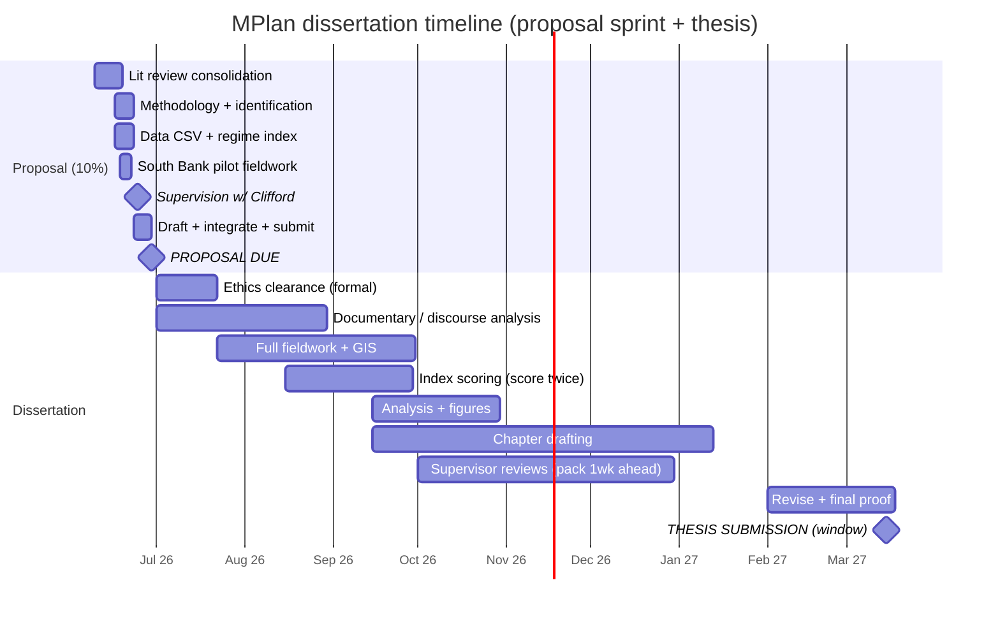

# Full Plan to 29 June — Design Proposal sprint + dissertation runway

**Target:** 3,000-word Design Proposal (10% of the MPlan dissertation mark), **due Monday 29 June 2026**.
**Today:** early June 2026. You have ~3 working weeks plus one final pre-submission supervision with Prof. Ben Clifford.
**Rule of the road:** the proposal must read as a single, exceptionally clear argument with a defensible method and an attached ethics form. The dissertation (15,000 words) is delivered later in the two-year MPlan; this plan also lays its runway so the proposal promises nothing you cannot deliver.

---

## 1. The research question and sub-objectives (locked)

**Research question (from `08`/`03`):**

> **How has the *publicness* of public space produced through London's riverside regeneration changed across successive phases of urban policy from the post-war era to the present — and what explains the trajectory?**

**Sub-objectives (these organise both the proposal's methods and the eventual chapters):**

1. **Periodise** London regeneration policy into defensible phases (welfarist → property-led/roll-back → urban renaissance/roll-out → viability/austerity → Public London Charter era).
2. **Select one comparable riverside public-space exemplar per phase** along a single walkable South Bank/Bankside transect, holding site-type and geography roughly constant so variation maps onto the *era/delivery model*.
3. **Measure** the publicness of each exemplar with one consistent instrument set (the public-benefit delivery hierarchy + Németh & Schmidt control index + Varna & Tiesdell star + GIS metrics).
4. **Explain** the trajectory through the periodisation of neoliberalisation and the development-viability mechanism (publicness as the squeezed residual).
5. **Adjudicate** the *privatisation* (Minton) vs *public-isation* (Carmona) debate against the longitudinal evidence, and assess whether re-regulation via the **Public London Charter (2020)** reverses the trend.

**The one-sentence thesis everything serves:** *market-led, deregulated delivery measurably degrades the publicness of regenerated riverside space; development viability is the mechanism, and re-regulation can partially reverse it.* (This transposes Clifford's housing-quality thesis to public space — see §9.)

---

## 2. Week-by-week work plan (8 → 29 June 2026)

Each week ends with a concrete, checkable output. Send the supervisor pack a full week before the meeting (your own note: "way to do a good job").

### Week 0 — this weekend (7–8 June): set up the sprint
- [ ] Confirm with the department the **exact submission portal, time and word-count rules** (does the ethics form count toward 3,000?).
- [ ] Send the meeting-request email to Prof. Clifford (Deliverable 2, file `12`) and propose dates in the week of **22–26 June** so he has seen materials before you finalise.
- [ ] Re-confirm the supervisor's name spelling and title on all documents (README flags this).

### Week 1 — 9–15 June: literature + question locked, ethics drafted
- [ ] **Consolidate the literature review** from `02` and `05` into three strands: (a) variegated neoliberalisation [Peck & Tickell; Brenner et al.; Harvey]; (b) publicness & its measurement [Németh & Schmidt; Varna & Tiesdell; Carmona]; (c) deregulation-degrades-quality [Clifford et al.]. End on the **gap**: publicness has rarely been *measured comparatively across governance regimes over time*.
- [ ] **Finalise the RQ + 5 objectives** wording (above) — freeze it; no more drift.
- [ ] **Draft the Bartlett ethics questionnaire + risk assessment** (observation-only, no personal data, lone-fieldwork-in-daylight mitigations). This is the auto-fail item — get a complete draft down now, polish later.
- [ ] Resolve every ⚠ reference you intend to cite (hand the list in §6 to the `dissertation-researcher` subagent).
- [ ] **Output:** finished §2 Literature Review draft (~800 words) + complete ethics draft.

### Week 2 — 16–22 June: methodology, instruments, and the South Bank pilot
- [ ] **Finalise the methodology**: case-selection logic, the three publicness instruments, the GIS metric list, and — critically — the **four-part identification strategy** that isolates regulation from technology and taste (`09`).
- [ ] **Build the data spine**: create `data/publicness_scores.csv` with the columns in `10` (one row per exemplar, including both halves of each failed-and-rebuilt pair) and code the **0–10 regulatory regime index** rubric.
- [ ] **Pilot fieldwork on the South Bank transect** (Festival of Britain/Southbank Centre → More London & The Scoop → One Blackfriars, with Elephant & Castle/Heygate just inland). Walk it in a day; trial the coding sheet on 2–3 sites; photograph fabric not faces; time the scoring to prove feasibility.
- [ ] Refine the observation coding sheet after the pilot; note inter-rater/consistency procedure (score twice).
- [ ] **Send the supervisor pack** (proposal-so-far + this plan + the email's questions) ~one week ahead of the meeting.
- [ ] **Output:** methodology draft (~900 words), populated pilot rows in the CSV, a tested coding sheet, one trial scatter.

### Week 3 — 23–29 June: draft, integrate, polish, submit
- [ ] **Supervision with Prof. Clifford** (early-mid week): extract decisions on case selection, ethics scope, regime-index defensibility, and archival sources (see §6 questions in file `12`).
- [ ] Draft the remaining sections to budget: **Statement of context (450)**, **Key question & aim (350)**, **Timetable + Gantt (200)**, **Risk assessment & ethics (300)**.
- [ ] **Integrate** the whole into one continuous argument; insert the Gantt (below) and the coding sheet as an appendix; attach the completed ethics form.
- [ ] Line-edit to a measured UK academic register; verify every citation against `05`; remove any ⚠ source not yet confirmed.
- [ ] **Proof + word-count check + reference-list check** (Sun 28 June), then **submit Mon 29 June** with a buffer — do not leave it to the final hour.

---

## 3. Gantt-style timetable

### 3a. Proposal sprint (June 2026) — week granularity

| Task | Wk1 (9–15) | Wk2 (16–22) | Wk3 (23–29) |
|---|---|---|---|
| Lit review consolidation | ███████ | ░░ |  |
| RQ + objectives freeze | ███ |  |  |
| Ethics questionnaire + risk assessment | █████ | ░░ (polish) | ░ (attach) |
| Methodology finalisation |  | ███████ | ░░ |
| Data CSV + regime index build |  | ██████ | ░ |
| South Bank pilot fieldwork |  | █████ |  |
| Supervisor pack sent |  | ██ (≈19 Jun) |  |
| Supervision w/ Clifford |  |  | ███ (early wk) |
| Draft remaining sections |  | ░ | ███████ |
| Integrate + Gantt + appendix |  |  | █████ |
| Proof + submit |  |  | ███ (submit 29) |

### 3b. Full dissertation runway (proposal → final thesis)

> Dissertation dates are indicative — confirm the official submission date for your cohort and back-plan from it. The discipline that matters: **fieldwork before scoring, scoring before analysis, a draft to the supervisor a full week before every meeting.**

---

## 4. Proposal sections mapped to word budgets (official brief headings)

| § | Section (brief heading) | Words | What it must do |
|---|---|---|---|
| 1 | **Statement of context** | 450 | The problem: contested publicness of regenerated riverside space; waterfront regeneration as the entrepreneurial-city flagship; why London and why *over time*. Open on the Minton-vs-Carmona tension. |
| 2 | **Review of literature** | 800 | Three strands (neoliberalisation / publicness measurement / deregulation-degrades-quality), closing on the **gap**: no consistent longitudinal measurement of publicness across regulatory regimes. |
| 3 | **Key question & aim** | 350 | The RQ + 5 objectives (§1 above); state explicitly that the study **adjudicates Minton vs Carmona** and tests the Charter as a corrective. |
| 4 | **Statement of methods** | 900 | Longitudinal "most-similar across time" design; the three publicness instruments + GIS; the **four-part identification strategy** (the headline methodological move); the regime index and scatter; documentary discourse analysis; **no interviews**; triangulation. Coding sheet as appendix. |
| 5 | **Timetable (Gantt)** | 200 + chart | The chart in §3; narrate critical path and supervisor checkpoints. |
| 6 | **Risk assessment & ethics** | 300 + form | Low-risk public observation; no personal data; lone-fieldwork mitigations; **attach the completed Bartlett ethics questionnaire — auto-fail without it.** |

**Total: 3,000 words** (excluding the attached ethics form and appendix coding sheet — confirm this exclusion with the department).

---

## 5. How data is gathered and interpreted (quantitative + observation only — NO interviews, light ethics)

**Gathered (per exemplar, one row in `data/publicness_scores.csv`):**

- **Public-benefit delivery hierarchy (your original instrument, 0–6):** provided → accessible → affordable → advertised → used → beneficial. Your methodological contribution; combined with the two published indices for triangulation.
- **Németh & Schmidt (2011) control index (0–1):** observation checklist across laws/rules, surveillance & policing, design/image (territoriality), access & comfort. Lower control = more open/public. Yields a 2-axis control-vs-comfort scatter.
- **Varna & Tiesdell (2010) star (1–5 on five dimensions):** ownership, control, civility, physical configuration, animation → a radar "star" per site (the most memorable figure).
- **Hostile/defensive-design counts** and **posted-rules counts** (observation).
- **Affordable-housing %** carried as a second, almost-purely-regulatory variable (S106 / planning records).
- **GIS metrics (QGIS):** % publicly accessible open space, number/width of entrances and permeability, green-space %, provision counts (benches/toilets per 100 m frontage), normalised per hectare/resident. Sources: OpenStreetMap, OS Open Greenspace, London Datastore.
- **Regulatory regime index (0–10):** an additive scale of "market-led-ness" of the consent regime — land ownership at delivery, consent route, perpetuity of public access, affordable-housing security, management model (each 0–2). This turns *regulation itself* into a plottable number.

**Interpreted:**

- **Trajectory line:** publicness vs year — the longitudinal story.
- **Failed-and-rebuilt paired bars (P1–P3):** Robin Hood Gardens→Blackwall Reach, Heygate→Elephant Park, Thamesmead→Peabody — same ground, different regime.
- **Contemporaneous matched-pair bars:** same-era spaces under different regimes — the cleanest evidence (holds technology and taste constant).
- **Headline scatter:** `regime_index` (x) vs `publicness` (y), one labelled point per space. If publicness falls as the regime becomes more market-led, **and points cluster by regime rather than by decade**, that single chart is quantitative evidence that regulation — not time/tech/taste — drives publicness.
- **Honest statistics:** with ~6–10 spaces this is an *intensive comparative design*. Report descriptives, difference scores (Δ = new − old by control type) and the scatter pattern; claim **analytical (theory-testing) generalisation, not statistical significance**. Markers reward this candour (`07`).

---

## 6. Key readings grouped by role (verified status carried from `05`)

Do **not** cite anything marked ⚠ until the `dissertation-researcher` confirms the flagged detail. Do not invent citations.

**Theory / periodisation**
- ✅ Peck, J. and Tickell, A. (2002) 'Neoliberalizing space', *Antipode*, 34(3), pp. 380–404.
- ✅ Brenner, N., Peck, J. and Theodore, N. (2010) 'Variegated neoliberalization', *Global Networks*, 10(2), pp. 182–222.
- ✅ Harvey, D. (1989) 'From managerialism to entrepreneurialism', *Geografiska Annaler B*, 71(1), pp. 3–17.

**Measurement of publicness (the instruments)**
- ✅ Németh, J. and Schmidt, S. (2011) 'The privatization of public space: modeling and measuring publicness', *Environment and Planning B*, 38(1), pp. 5–23.
- ⚠ Varna, G. and Tiesdell, S. (2010) 'Assessing the publicness of public space: the star model of publicness', *Journal of Urban Design*, 15(4), pp. 575–598. *(confirm issue/pages)*
- ✅ Carmona, M. (2015) 'Re-theorising contemporary public space', *Journal of Urbanism*, 8(4), pp. 373–405.
- ✅ Carmona, M. and Wunderlich, F.M. (2012) *Capital Spaces*. London: Routledge.

**Mechanism (viability / deregulation degrades quality — the Clifford anchor)**
- ✅ Clifford, B., Ferm, J., Livingstone, N. and Canelas, P. (2019) *Understanding the Impacts of Deregulation in Planning*. Cham: Palgrave Macmillan.
- ✅ Ferm, J., Clifford, B., Canelas, P. and Livingstone, N. (2021) 'Emerging problematics of deregulating the urban', *Urban Studies*, 58(10), pp. 2040–2058.
- ✅ Clifford, B. et al. (2020) *Research into the Quality Standard of Homes Delivered through Change of Use Permitted Development Rights*. London: MHCLG.
- ⚠ Madeddu, M. and Clifford, B. (2022) 'The conversion of buildings to housing use', *Progress in Planning*. *(confirm volume/pages)*
- ✅ Ferm, J. and Raco, M. (2020) 'Viability planning, value capture and the geographies of market-led planning reform in England', *Planning Theory & Practice*, 21(2), pp. 218–235.
- ✅ Foye, C. (2022) 'Section 106, viability, and the depoliticization of English land value capture policy', *IJURR*, 46(2), pp. 269–286.
- ✅ McAllister, P., Street, E. and Wyatt, P. (2016) 'Governing calculative practices', *Urban Studies*, 53(11), pp. 2363–2379.

**London regeneration history + the debate**
- ✅ Brownill, S. (1990) *Developing London's Docklands: Another Great Planning Disaster?* London: Paul Chapman.
- ⚠ Brownill, S. (2013) *London Docklands: Reflections on Regeneration*. London: Routledge. *(confirm year/edition)*
- ✅ Urban Task Force (1999) *Towards an Urban Renaissance*. London: DETR/E&FN Spon.
- ✅ Imrie, R. and Raco, M. (eds.) (2003) *Urban Renaissance?* Bristol: Policy Press.
- ✅ Punter, J. (2011) 'Urban design and the English urban renaissance 1999–2009', *Journal of Urban Design*, 16(1), pp. 1–41.
- ⚠ Lees, L. (2014) 'The urban injustices of New Labour's "urban renaissance": the case of the Aylesbury estate', *Antipode*, 46(4), pp. 921–947. *(confirm vol/issue/pages)*
- ⚠ Lees, L. and Ferreri, M. (2016) 'Resisting gentrification on its final frontiers: the Heygate Estate (1974–2013)', *Cities*, 57, pp. 14–24. *(confirm authorship/pages)*
- ✅ Minton, A. (2012) *Ground Control*. 2nd edn. London: Penguin. *(1st edn 2009; pessimist pole — use as position to test)*
- ✅ Carmona, M. (2019) 'Principles for public space design', *Urban Design International*, 24(1), pp. 47–59.
- ⚠ Carmona, M. (2021) 'The "public-isation" of private space', *Journal of Urbanism*. *(confirm vol/issue/pages; revisionist pole)*
- ✅ Centre for London (2019) *Public London: Investigating the Regulation of Public Spaces*. London: Centre for London/GLA.
- ✅ Mayor of London (2020) *Public London Charter*. London: GLA.
- ✅ Shenker, J. (2017) 'Revealed: the insidious creep of pseudo-public space in London', *The Guardian*, 24 July. *(discourse source, not neutral evidence)*

**Failed-and-rebuilt case sources**
- ✅ Twentieth Century Society (n.d.) *Robin Hood Gardens, Poplar, London*. *(1972 Smithsons estate; demolition; listing refused)*
- ⚠ *Architects' Journal* (2025) on Blackwall Reach Phase 2. *(confirm author/date; ~45–60% affordable across ~1,575-home scheme)*
- ✅ Peabody / Thamesmead Now (n.d.) *Thamesmead's History*. *(GLC 1966 masterplan; Peabody from 2014)*

**Methods / normative stakes**
- ⚠ Kohn, M. (2004) *Brave New Neighborhoods*. New York: Routledge. *(confirm pages when quoting)*
- (Optional, conclusion only) ⚠ Thompson, M. (2021) 'What's so new about New Municipalism?', *Progress in Human Geography*, 45(2), pp. 317–342.

---

## 7. Risks and ethics checklist

**Ethics (auto-fail without the completed form):**
- [ ] Bartlett ethics questionnaire **completed and attached** to the proposal.
- [ ] Risk assessment attached (lone fieldwork on the South Bank transect, daylight, public areas; phone-charged, check-in contact, no entry to private/secured interiors without permission).
- [ ] Observation of **public behaviour and fabric only — no personal data, no interviews, no recording of identifiable individuals**.
- [ ] **Photographs of fabric/features, not faces**; avoid identifiable individuals.
- [ ] No GDPR processing because no personal data is collected (state this explicitly).

**Research risks and mitigations:**
- [ ] **Confound critique (the big one)** — handled by the four-part identification strategy (see §8). Present it as a *strength*.
- [ ] **Retrospective scoring of historic/demolished spaces** — triangulate archival plans/photos + present-day survivals + secondary accounts; flag uncertainty per item.
- [ ] **Observer dependence of indices** — publish the coding sheet, score twice, report consistency.
- [ ] **Small N (~6–10 spaces)** — frame as intensive comparative/analytical design; no significance claims.
- [ ] **Access to a historic exemplar fails** — fallback to a tighter 3–4 case set (Docklands vs More London vs One Blackfriars) without breaking the design.
- [ ] **Time risk** — the critical path is methodology → pilot → draft; protect Week 2.

---

## 8. Confound control — regulation vs technology vs taste (per `09`)

The dissertation's key contribution is attributing measured publicness change to the **regulatory regime (the treatment)** while controlling three confounds: **C1 technology**, **C2 preferences/taste**, **C3 site/context**. Four moves, used together:

- **A — Measure only regulation-sensitive attributes.** Score ownership, secured access rights, posted rules, policing regime, S106-secured provision and affordable %; *do not* score architectural style, materials or "whether it looks nice". This designs the confound out at source.
- **B — Same-site failed-and-rebuilt pairs** (P1–P3) hold **site/context (C3)** constant.
- **C — Contemporaneous matched pairs** (same era → same technology and taste) hold **C1 and C2** constant — the decisive control.
- **D — Regulatory discontinuities** pin each inflection to a datable law/policy change (1980 LGPLA/UDCs; 2012 NPPF viability turn; 2017–2021 London Plan D7 + Public London Charter), so the explanation names the regulation rather than gesturing at "neoliberalism".

Triangulating B and C means no single confound explains the pattern: B rules out site effects, C rules out technology and taste, A minimises their entry, D names the operative regulation. State plainly: this is a most-similar-systems / natural-experiment logic supporting **analytical, not statistical, generalisation.**

---

## 9. Mapping the plan to the UCL Distinction criteria (`07`)

| Criterion (A / A+) | How this plan delivers it |
|---|---|
| **Exceptionally clear argument** | One thesis (market-led delivery degrades publicness; viability is the mechanism), one RQ, five objectives driving every section. |
| **Integrates a range of sources** | Theory + measurement + mechanism + London history + primary observation + quantitative indices, grouped and verified in §6. |
| **Depth + analytical rigour** | The viability mechanism *explains* the pattern; the four-part identification strategy makes the causal claim defensible; replicable scoring with limitations stated. |
| **Originality** | Your **public-benefit delivery hierarchy** operationalised and combined with published indices; the **0–10 regime index**; transposing Clifford's housing-quality thesis to public space, longitudinally. |
| **Perceptive conclusions** | Adjudicates Minton vs Carmona with your own data and tests whether the Charter reverses the trend. |
| **Exemplary connections (A+)** | Links planning theory ↔ land economics/viability ↔ urban design ↔ political economy — across the whole MPlan curriculum. |
| **Publishable quality (A+)** | A clean comparative publicness dataset + the hierarchy-as-method is genuinely publishable. |

**Anti-patterns to avoid (markers penalise):** generic/descriptive "could-be-AI" prose — always *critique*, never summarise; reading only from slides; uncited overclaims; unresolved discrepancies in figures. Keep every ⚠ source out until confirmed.
